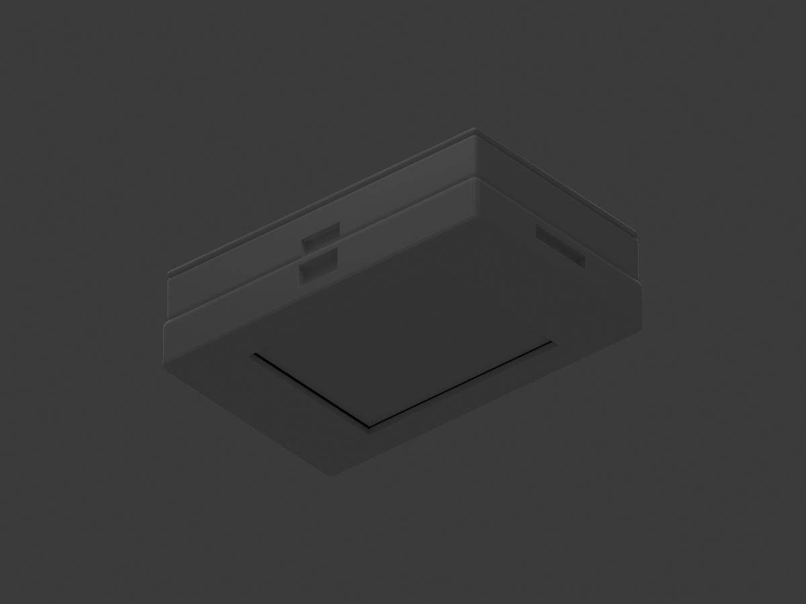

# ESP32 2.8-Inch Touch Display Case

A Blender-designed, 3D-printable enclosure for the ELEGOO ESP32 CYD 2.8-inch touch-display board, with a separate rear compartment intended for the linked 3.7 V, 2000 mAh LiPo battery.



## Project status

The editable Blender project, procedural generator, preview, and three STL exports are included. The model was opened and exported with Blender 5.2.2 LTS. This is a **parametric prototype**, not a verified physical fit: the battery listing gives capacity but not cell dimensions, and the board's exact port positions/revision should be checked before printing a full case.

## Design at a glance

| Feature | Current model |
|---|---:|
| Case envelope | 98 × 62 × 28.3 mm |
| Target board outline | 86 × 50 mm, CYD / ESP32-2432S028R family |
| Board pocket | 87 × 51 mm (0.5 mm nominal clearance per side) |
| Display opening | 58.8 × 44 mm |
| Nominal battery pocket | 72 × 44 × 10.5 mm; **unverified placeholder** |
| Main parts | Front bezel/cradle, battery tray/separator, rear lid |
| Fasteners | 4 × M3 × 25 mm screws; 3.2 mm clearance bores and 2.6 mm front pilot holes |

## Files

- `model/ESP32_CYD_2000mAh_Case.blend` — editable native Blender scene.
- `model/esp32_cyd_case_generator.py` — parameterized Blender Python generator; run it in Blender's Scripting workspace to regenerate the project, STLs, and preview.
- `model/ESP32_CYD_front_bezel.stl` — front bezel and board cradle.
- `model/ESP32_CYD_battery_tray.stl` — rear battery pocket and separator.
- `model/ESP32_CYD_battery_lid.stl` — removable rear lid.
- `images/ESP32_CYD_Case_preview.png` — rendered assembly preview; the display mockup is visualization-only and is not in the STLs.
- `docs/` — hardware references, assembly/print notes, and verification results.
- `tools/validate_project.py` — checks Blender mesh edge use, scene dimensions, STL counts, and exported bounds.

To rerun the validation script with a compatible Blender Python environment, use:

```bash
uv run --python 3.13 --with bpy python tools/validate_project.py
```

It checks closed edge-use counts and STL file structure/bounds; it does not replace slicer inspection or a physical fit test.

## Before printing

1. Measure the battery cell **including** the protection board, lead, and connector. Capacity does not determine size. The current 72 × 44 × 10.5 mm pocket is not claimed to fit the linked battery until measured.
2. Confirm your board is the expected CYD revision and check the USB-C and microSD positions against the side openings.
3. Print a small clearance/port test or a low-cost draft before the full enclosure. Printer tolerances and the included acrylic protector can affect fit.
4. Read [`docs/assembly-and-printing.md`](docs/assembly-and-printing.md) and [`docs/design-and-fit.md`](docs/design-and-fit.md) for caveats and dimensions.

## Hardware links

- Display board listing: [ELEGOO ESP32 2.8-Inch Touch Displays](https://www.amazon.com/dp/B0FJQ6RK39)
- Battery listing: [YELUFT 3.7 V 2000 mAh LiPo, JST 1.25](https://www.amazon.com/dp/B0FPCWFFYB)

The listings may change; use the physical hardware and its mechanical drawing/measurements as the final authority.
